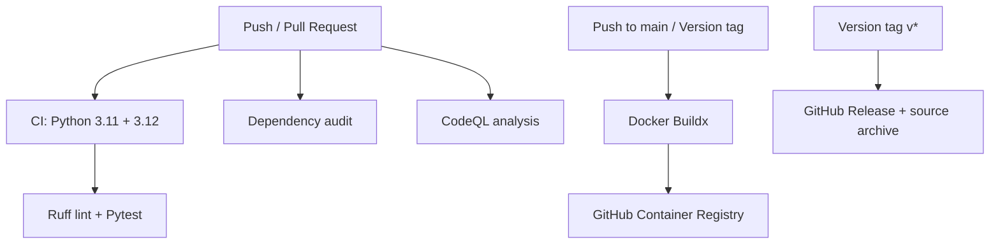

# GitHub Actions CI/CD Automation | Python + Docker + GHCR

   

A hands-on portfolio project demonstrating **continuous integration, automated testing, dependency auditing, static security analysis, container publishing, and versioned releases** with GitHub Actions. This repository contains runnable code and workflows, not merely pipeline screenshots.

> **Project status:** Reference implementation. Verify the workflows in your own GitHub repository before describing them as successfully deployed. The pipeline **publishes a Docker image to GHCR**, but does not deploy to a production server.

## Architecture



## What this demonstrates

| Area | Implementation | Trigger |
|---|---|---|
| Quality gates | Ruff and Pytest across Python 3.11 and 3.12 | Push to main/develop; PR to main; manual |
| Dependency security | `pip-audit` | Push to main/develop; PR to main; manual |
| Code scanning | CodeQL for Python | Push/PR to main; weekly |
| Container delivery | Docker Buildx with GitHub Actions cache and GHCR publication | Push to main, version tags, manual |
| Release automation | GitHub release with compressed source bundle | Version tags `v*` |
| Least privilege | Per-workflow `GITHUB_TOKEN` permissions | Every workflow |

## Repository layout

```text
github-actions-cicd/
├── .github/
│   └── workflows/
│       ├── ci.yml
│       ├── codeql.yml
│       ├── docker.yml
│       └── release.yml
├── app/
│   ├── __init__.py
│   └── main.py
├── tests/
│   └── test_main.py
├── scripts/
│   └── run-local.sh
├── docs/
│   └── LINKEDIN.md
├── .dockerignore
├── .gitignore
├── Dockerfile
├── requirements.txt
└── README.md
```

## Prerequisites

- Git, Python 3.11 or 3.12, and pip
- Docker Desktop (optional for local image builds)
- GitHub repository with GitHub Actions enabled
- Permission to publish GitHub Packages through `GITHUB_TOKEN` (organization policies may differ)

## Run locally

**Windows PowerShell:**

```powershell
py -3.12 -m venv .venv
.\.venv\Scripts\Activate.ps1
python -m pip install -r requirements.txt
ruff check app tests
python -m pytest -v
python -m app.main
```

**Linux/macOS:**

```bash
python3 -m venv .venv
source .venv/bin/activate
python -m pip install -r requirements.txt
ruff check app tests
python -m pytest -v
python -m app.main
```

Visit `http://localhost:8080/health`. Expected JSON: `{"status":"healthy"}`.

## Docker local verification

```bash
docker build -t github-actions-demo:local .
docker run --rm -p 8080:8080 github-actions-demo:local
```

In another terminal: `curl http://localhost:8080/health`.

## Upload to GitHub (preserve folders)

**Recommended: Git CLI**

1. Extract the ZIP. Open PowerShell inside `github-actions-cicd` (the folder containing `README.md`).
2. Create an **empty** public GitHub repository, e.g. `github-actions-cicd` (do not initialize it with a README).
3. Execute:

```powershell
git init
git branch -M main
git add .
git commit -m "Initial GitHub Actions CI/CD project"
git remote add origin https://github.com/YOUR_USERNAME/github-actions-cicd.git
git push -u origin main
```

Replace `YOUR_USERNAME` with your account username. Git automatically retains `.github/workflows/` and all subfolders. To use the browser instead, open the repository, choose **Add file → Upload files**, and drag the extracted project folder's *contents* (including the hidden `.github` folder) into the upload area. Check the resulting paths before committing.

## Verify workflows

1. Navigate to **Actions** and confirm the CI, Docker, and CodeQL workflows run after pushing to `main`.
2. Open **Actions → CI - Lint Test Security** and inspect both Python matrix jobs plus the dependency audit.
3. Open the repository's **Packages** section to locate the published image. Package visibility can be changed in package settings if needed.
4. Open **Security → Code scanning** for CodeQL findings (availability depends on repository and plan).
5. Test the pull request quality gate by creating a feature branch, changing a test, and opening a PR to `main`.

**Create a release tag:**

```powershell
git tag -a v1.0.0 -m "Initial release"
git push origin v1.0.0
```

Check **Actions**, **Releases**, and **Packages** after the tag push. If the repository or organization disables Actions write permissions, adjust the workflow permissions or ask an administrator. Release creation requires `contents: write`; GHCR publishing requires `packages: write`.

## Workflow explanation

### CI (`ci.yml`)
Runs a two-version Python matrix, lints code with Ruff, and tests API endpoints using Flask's test client. A separate job checks Python dependencies for published vulnerabilities. A vulnerability finding causes the audit job to fail and should be triaged, not silently ignored.

### CodeQL (`codeql.yml`)
Runs static analysis for Python on main and pull requests and every Monday. The code-scanning feature and upload permissions must be available for your repository configuration.

### Docker (`docker.yml`)
Authenticates with the ephemeral GitHub token and publishes a container image to `ghcr.io/<owner>/<repo>`. Tags are derived from branches, Git tags, and commit SHAs. The build uses GitHub Actions layer caching. This workflow runs independently of CI; **publication is not gated on CI success**. For a stricter production pipeline, add a reusable CI workflow dependency or use branch protection rules.

### Release (`release.yml`)
On `v*` tags, creates a compressed source archive and GitHub Release. Use signed/protected tags and a release approval policy for production-grade release controls.

## Security and operational considerations

- No personal access token is needed for same-repository GHCR publishing when `GITHUB_TOKEN` permissions allow it.
- Do not commit credentials or `.env` files. Use GitHub environments, encrypted secrets, and OIDC for external cloud deployment.
- For production, pin third-party Actions to audited full commit SHAs, pin Python dependencies, generate an SBOM, scan container images, and require protected branches and approvals.
- GHCR image publication is **not** Kubernetes deployment or cloud deployment. Add a dedicated deployment workflow and environment protection for those capabilities.
- The sample app is intentionally small so the automation is easy to understand and extend.

## Suggested enhancements

1. Add integration tests and code coverage reports.
2. Introduce Trivy image scanning and SBOM generation.
3. Deploy to a staging environment with OIDC and protected environments.
4. Gate image publishing on successful CI and security checks.
5. Add deployment rollback, monitoring, and notifications.

## Resume / portfolio summary

Designed a GitHub Actions CI/CD reference pipeline for a containerized Python API, including multi-version automated tests, linting, dependency auditing, CodeQL static analysis, Docker image publication to GHCR, and version-tagged GitHub releases.

## License

Use and adapt this example for learning and portfolio demonstrations. No separate license grant is provided for third-party dependencies; follow their respective licenses.
